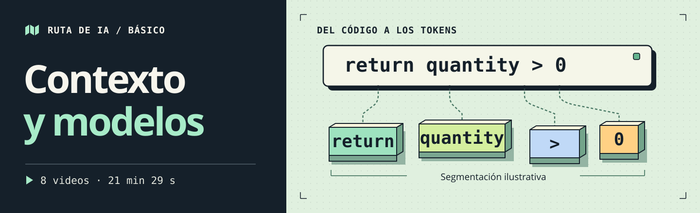

# Básico · Fundamentos con GitHub Copilot

Empieza con una pregunta sobre una función que acepta pedidos de cero unidades. A medida que adjuntas el código y las pruebas, verás qué información usa Copilot, qué puede hacer un agente y cómo comprobar su respuesta en VS Code.

**8 episodios · 21:29 en total.** Narración en inglés, subtítulos seleccionables y un capítulo por escena. En el selector de audio puedes elegir la mezcla con diseño sonoro o la voz sola.

[Descargar el primer episodio (B01)](https://github.com/Finithe-Phoenix/Path-Level-1-IA/raw/v3.0.0/videos/B01.mp4) · [Editar o reconstruir los videos](PRODUCCION.md)

Un prisma abre la ruta. En B01 sigues el cero hasta la comparación y ves qué resultado devuelve el validador.

[Ver y escuchar el mismo paso en las ediciones 2 y 3](https://github.com/Finithe-Phoenix/Path-Level-1-IA/raw/v3.0.0/docs/comparacion-B01.mp4).

## Temario

Selecciona el título para descargar el video. Puedes activar los subtítulos en tu reproductor o descargar el archivo SRT de cada episodio.

| Episodio | Qué harás en pantalla |
| --- | --- |
| **B01** · [How a Language Model Uses Context](https://github.com/Finithe-Phoenix/Path-Level-1-IA/raw/v3.0.0/videos/B01.mp4) 2:40 · [SRT](https://github.com/Finithe-Phoenix/Path-Level-1-IA/raw/v3.0.0/subtitles/B01.en.srt) | Adjunta el validador de pedidos y predice qué devolverá para cero y para uno. |
| **B02** · [The Main Types of AI Models](https://github.com/Finithe-Phoenix/Path-Level-1-IA/raw/v3.0.0/videos/B02.mp4) 2:46 · [SRT](https://github.com/Finithe-Phoenix/Path-Level-1-IA/raw/v3.0.0/subtitles/B02.en.srt) | Elige entre generar texto, buscar por similitud o clasificar un ticket según el resultado que necesitas. |
| **B03** · [OpenAI, Anthropic, and Microsoft Models](https://github.com/Finithe-Phoenix/Path-Level-1-IA/raw/v3.0.0/videos/B03.mp4) 2:47 · [SRT](https://github.com/Finithe-Phoenix/Path-Level-1-IA/raw/v3.0.0/subtitles/B03.en.srt) | Identifica al fabricante, la plataforma y el cliente de un modelo de OpenAI, Anthropic o Microsoft. Comprueba cuál aparece en tu sesión. |
| **B04** · [Choose a Model for the Task](https://github.com/Finithe-Phoenix/Path-Level-1-IA/raw/v3.0.0/videos/B04.mp4) 2:42 · [SRT](https://github.com/Finithe-Phoenix/Path-Level-1-IA/raw/v3.0.0/subtitles/B04.en.srt) | Compara dos modelos con el mismo issue y puntúa sus respuestas con cuatro resultados esperados. |
| **B05** · [What Is an AI Agent?](https://github.com/Finithe-Phoenix/Path-Level-1-IA/raw/v3.0.0/videos/B05.mp4) 2:43 · [SRT](https://github.com/Finithe-Phoenix/Path-Level-1-IA/raw/v3.0.0/subtitles/B05.en.srt) | Sigue una llamada a una herramienta. Comprueba el comando propuesto y decide cuándo debe terminar la sesión. |
| **B06** · [Prompt Engineering for Coding Tasks](https://github.com/Finithe-Phoenix/Path-Level-1-IA/raw/v3.0.0/videos/B06.mp4) 2:33 · [SRT](https://github.com/Finithe-Phoenix/Path-Level-1-IA/raw/v3.0.0/subtitles/B06.en.srt) | Convierte «arregla esto» en un prompt con un defecto observable, un alcance y una prueba de aceptación. |
| **B07** · [Give Copilot the Right Context](https://github.com/Finithe-Phoenix/Path-Level-1-IA/raw/v3.0.0/videos/B07.mp4) 2:41 · [SRT](https://github.com/Finithe-Phoenix/Path-Level-1-IA/raw/v3.0.0/subtitles/B07.en.srt) | Adjunta el issue, la función y las pruebas. Comprueba si la respuesta cita la línea que admite el cero. |
| **B08** · [Verify and Undo an AI Edit](https://github.com/Finithe-Phoenix/Path-Level-1-IA/raw/v3.0.0/videos/B08.mp4) 2:37 · [SRT](https://github.com/Finithe-Phoenix/Path-Level-1-IA/raw/v3.0.0/subtitles/B08.en.srt) | Revisa el diff, elimina la edición ajena al issue y vuelve a ejecutar las pruebas sobre el cambio que conservas. |

Ver un fragmento animado de B01

## Laboratorio de práctica

El proyecto incluye el validador de cantidades y tres pruebas iniciales. Puedes reproducir el fallo con un pedido de cero unidades y comprobar el resultado de tu arreglo en el workspace autorizado. [Abrir el laboratorio](lab/README.md).

## Fuentes editables

Para preparar una nueva edición, empieza por el guion y las referencias técnicas de cada escena. El repositorio también guarda los dibujos, la toma original de voz, el audio final y sus marcas de tiempo. [Guiones y referencias](lessons/episodes.json) · [Guía de producción](PRODUCCION.md) · [Guía para agentes](AGENTS.md) · [Descargar las fuentes de v3.0.0 en ZIP](https://github.com/Finithe-Phoenix/Path-Level-1-IA/archive/refs/tags/v3.0.0.zip).

[Consultar la edición anterior](https://github.com/Finithe-Phoenix/Path-Level-1-IA/releases/tag/v2.0.0).

## Otras rutas

[Medio](https://github.com/Finithe-Phoenix/Path-Level-2-IA) · [Avanzado](https://github.com/Finithe-Phoenix/Path-Level-3-IA) · [Managers](https://github.com/Finithe-Phoenix/Path-Level-Managers-IA)
